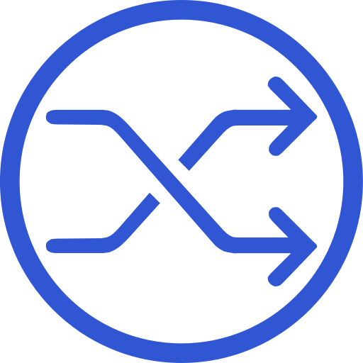

# Changedetection.io

Changedetection.io **watches web pages and tells you when they change.** Point
it at a URL, pick how often to check, and it fetches the page, diffs it against
the last version, and notifies you (email, Telegram, ntfy, Discord, webhooks,
~80 services via Apprise) when something's different. Great for: price drops and
restocks, a job or housing board, a government/policy page, a competitor's
pricing, a changelog, a "last updated" field — anything you'd otherwise keep
refreshing by hand. You can watch just a CSS selector or a visual region, filter
out noise, and require a keyword before it alerts.

Two containers: the **app** (scheduler + UI + diff engine) and a headless
**Chrome** sidecar (`sockpuppetbrowser`) for pages that only render with
JavaScript. The browser isn't exposed — only the app talks to it.


<p align="center">
  
</p>

<br>


## Official container images

- App: [`ghcr.io/dgtlmoon/changedetection.io`](https://github.com/dgtlmoon/changedetection.io)
- Browser: [`dgtlmoon/sockpuppetbrowser`](https://github.com/dgtlmoon/sockpuppetbrowser)

Pin the app to a release (here `0.70.3`). The browser sidecar is optional — drop
it if you only watch plain HTML pages — but most real-world sites need it now.

## Deployment Notes

- **Set a UI password.** The app is open by default. In the UI go to
  *Settings → turn on password protection* immediately — it's a tool that can
  reach out to arbitrary URLs, don't leave it open.
- **`BASE_URL`** should match how you reach the UI (your proxied `https://`
  host) so notification links point to the right place.
- **The browser is internal.** `sockpuppetbrowser` publishes **no port** — the
  app reaches it at `ws://browser:3000` over the docker network. Don't add a
  `ports:` mapping to it; nothing outside the stack should talk to it.
- **`shm_size`** on the browser matters — Chrome crashes rendering big pages
  without enough shared memory (2gb is a safe default).
- **Concurrency:** `FETCH_WORKERS` / `MAX_CHROME` control parallelism. Keep them
  modest so you don't peg CPU or hammer the sites you watch (be a polite
  scraper — set sane check intervals, not every-minute on someone's small site).
- **Data:** everything (watches, history, settings) lives in the
  `changedetection-data` volume — that's your backup target.

### Security note

Both containers need **internet egress** (they fetch the sites you watch), so
neither is on an `internal` network — this is a continuation of hardening entry
06's point: segment what you can, allow egress where the job needs it. The
browser needs `SYS_ADMIN` for Chrome's sandbox (one deliberate `cap_add`, see
entry 03) — which is exactly why it stays **unexposed**: no published port,
reachable only by the app. Put the app behind your reverse proxy + TLS and keep
its password on.

## Example Use

```bash
cp docker-compose.example.yml docker-compose.yml
cp .env.example .env
# edit .env — set BASE_URL, TZ, pin versions
docker compose up -d
# open http://<host>:5000 → Settings: set a password → add your first watched URL
```

## Thanks

Thanks to [dgtlmoon](https://github.com/dgtlmoon/changedetection.io) and
contributors for Changedetection.io.

## Links

- Source: https://github.com/dgtlmoon/changedetection.io
- Docs / wiki: https://github.com/dgtlmoon/changedetection.io/wiki
- Notifications (Apprise): https://github.com/caronc/apprise
