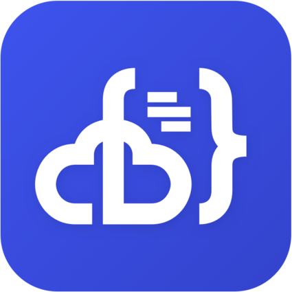

# code-server

**code-server** runs **VS Code in your browser**, served from your own machine.
It's the full editor — file explorer, integrated terminal, extensions, themes,
Git, debugging — but the heavy lifting (and your code) stays on the server, so
you can work from a laptop, a tablet or someone else's computer and pick up
exactly where you left off. It's ideal for a homelab: keep one proper dev
environment on a capable box and reach it from any thin device, or edit your
server's configs and scripts without SSH gymnastics. Built and maintained by
Coder from the real VS Code source.

  

 

## Official container image

- **Image:** `codercom/code-server`
- **Project:** https://github.com/coder/code-server
- **Docs:** https://coder.com/docs/code-server

## Deployment Notes

- **One container.** Single `code-server` service (Debian-based). Runs as the
  `coder` user (UID 1000) inside.
- **Single HTTP interface** on port `8080`.
- **Password.** `PASSWORD` sets the web login (required here) — generate a
  strong one (`openssl rand -hex 16`). Without auth, anyone reaching the port
  gets a full editor **and terminal** on your server, so never expose it
  unprotected; put it behind HTTPS (reverse proxy) for remote use.
- **Persistent state.** Named volume `code_server_config`
  (`/home/coder/.config` — settings and installed extensions) plus a
  bind-mounted **project folder** (`/home/coder/project`) where your code lives
  on the host.
- **File ownership.** The container runs as UID 1000; make sure your
  `PROJECTS_PATH` on the host is owned by (or writable to) UID 1000, or saves
  fail.
- **Pinned version.** `.env` pins `CODE_SERVER_VERSION`. Verified latest at
  build time: `v4.143.1`.
- **Healthcheck** curls the `/healthz` endpoint.
- **Optional hardening** (commented): `cap_drop: [ALL]`, `read_only: true`,
  `tmpfs: [/tmp]` — note a dev container usually needs a writable filesystem, so
  test carefully before enabling `read_only`.
- **Resource limits** and all environment-specific values are externalized to
  `.env`.

## Example Use

- Keep one powerful dev environment on your server, reach it from any device.
- Edit server configs, scripts and compose files in a real editor, no SSH.
- Code on a tablet/Chromebook with the full VS Code experience.
- Install the extensions you like once; they persist in the config volume.

## Thanks

To **Coder** and the code-server contributors for bringing VS Code to the
browser, self-hosted.

## Links

- Project: https://github.com/coder/code-server
- Documentation: https://coder.com/docs/code-server
- FAQ: https://coder.com/docs/code-server/FAQ
