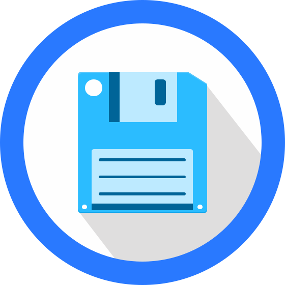

# Filebrowser

**Filebrowser** gives you a clean web interface to a folder on your server —
browse, upload, download, rename, move, edit text files, preview images and
media, create share links, and manage users, all from the browser. It's a tiny
single binary with no database server to run, so it's the quickest way to get a
"files in the browser" experience on a box: drop it in front of a directory and
you have a lightweight alternative to SFTP or a full cloud suite. For a homelab
it's handy for quick file shuffling, letting someone grab a file via a share
link, or editing configs without SSH.

  

 

## Official container image

- **Image:** `filebrowser/filebrowser`
- **Project:** https://github.com/filebrowser/filebrowser
- **Docs:** https://filebrowser.org/

## Deployment Notes

- **One container.** Single tiny `filebrowser` service (Go, Alpine-based) — no
  separate database server (it uses an embedded file DB).
- **Runs as your user.** `user: PUID:PGID` (default `1000:1000`) so files you
  create/upload get the right ownership — set these to match the owner of the
  managed folder.
- **Single HTTP interface** on port `80` (mapped to `8081` here).
- **Persistent state.**
  - `FB_ROOT_PATH` (host) → `/srv`: the **folder you want to manage**.
  - `filebrowser_db` (named volume) → `/database`: the app database (users,
    settings, share links). Pointed at by `FB_DATABASE`. Back this up.
- **First login.** Default credentials are **`admin` / `admin`** — change the
  password immediately after the first login, and never expose it unprotected
  (a file manager = read/write access to the mounted folder).
- **Pinned version.** `.env` lets you pin `FB_VERSION`; pin a release tag for
  reproducible rebuilds.
- **Healthcheck** fetches `/health` with the image's busybox `wget`.
- **Optional hardening** (commented): `cap_drop: [ALL]`, `read_only: true`,
  `tmpfs: [/tmp]` — enable after testing.
- **Resource limits** and all environment-specific values are externalized to
  `.env`.

## Example Use

- Upload/download and organise files on your server from any browser.
- Edit config files or scripts quickly without opening an SSH session.
- Create a share link to hand a file to someone (with optional expiry/password).
- Give a scoped user access to just one folder.

## Thanks

To the **Filebrowser** project and its contributors for a fast, no-fuss
web file manager.

## Links

- Project: https://github.com/filebrowser/filebrowser
- Documentation: https://filebrowser.org/
- Configuration: https://filebrowser.org/configuration
