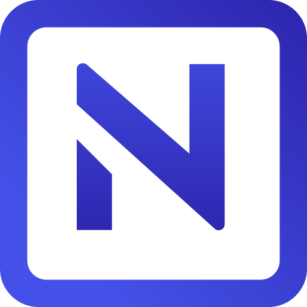

# NocoDB

NocoDB is an **open-source Airtable alternative** — it turns a database into a
friendly, collaborative "smart spreadsheet." You get grid, kanban, gallery and
calendar views over your tables, forms to collect data, relations between
tables, roll-ups and formulas, role-based sharing, and an auto-generated
REST/GraphQL API over everything. Great for trackers, inventories, light CRMs,
project boards, content calendars — anywhere you'd reach for Airtable or a pile
of spreadsheets, but want to own the data.

This stack runs NocoDB on **PostgreSQL**, which is the right choice for anything
real (NocoDB can use a built-in SQLite, but Postgres is sturdier and what you
want for shared, growing data).


<p align="center">
  
</p>

<br>


## Official container images

- App: [`nocodb/nocodb`](https://hub.docker.com/r/nocodb/nocodb)
  ([nocodb/nocodb](https://github.com/nocodb/nocodb))
- DB: [`postgres`](https://hub.docker.com/_/postgres) (official)

Pin the app to a release (here `2026.10.1`) and Postgres to a major
(`16-alpine`).

## Deployment Notes

- **First run = you're the super admin.** Open the UI and the first account you
  create becomes the instance super admin. Create it immediately, before anyone
  else can reach the page.
- **`NC_AUTH_JWT_SECRET`** signs login tokens — generate it once
  (`openssl rand -hex 32`) and keep it stable; changing it logs everyone out.
- **`NC_PUBLIC_URL`** should match how you actually reach NocoDB (your proxied
  `https://` host) so invite and share links point to the right place.
- **Database:** the app connects to Postgres over the internal network via the
  `NC_DB` string, built from your `POSTGRES_*` values. Generate a strong
  `POSTGRES_PASSWORD`.
- **Data:** table data lives in Postgres (`nocodb-db` volume); uploaded
  attachments and local metadata live in `nocodb-data`. Back up **both**.
- **Port:** app on container `8080`, published as `${NOCODB_PORT}`. Set
  `LISTEN_ADDR=127.0.0.1` to keep it host-only behind your reverse proxy.

### Security note

- The Postgres container is on an **internal, no-egress network** (hardening
  entry 06) — reachable only by NocoDB.
- Bind address is configurable (entry 07); default `0.0.0.0` for out-of-the-box
  use, set `127.0.0.1` for a proxied deploy.
- NocoDB has its own accounts/roles — but it's a prime candidate to *also* sit
  behind your reverse proxy with TLS, and optionally forward-auth/SSO (entry 10)
  if you expose it beyond your LAN.

## Example Use

```bash
cp docker-compose.example.yml docker-compose.yml
cp .env.example .env
# generate secrets:  openssl rand -hex 32  (JWT)   /   openssl rand -hex 24  (DB)
# edit .env — paste both, set NC_PUBLIC_URL, LISTEN_ADDR
docker compose up -d
# open http://<host>:8080 → create the super-admin account → build your first base
```

## Thanks

Thanks to the [NocoDB](https://github.com/nocodb/nocodb) team for a genuinely
pleasant open-source no-code database.

## Links

- Docs: https://docs.nocodb.com/
- Source: https://github.com/nocodb/nocodb
- Self-host guide: https://docs.nocodb.com/getting-started/self-hosted/installation
